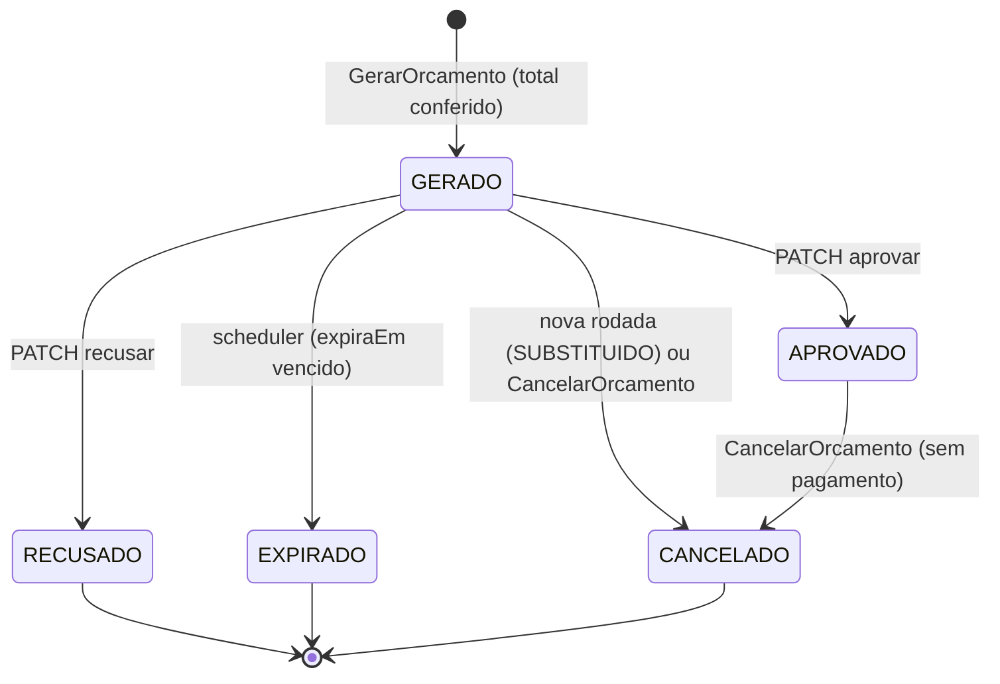
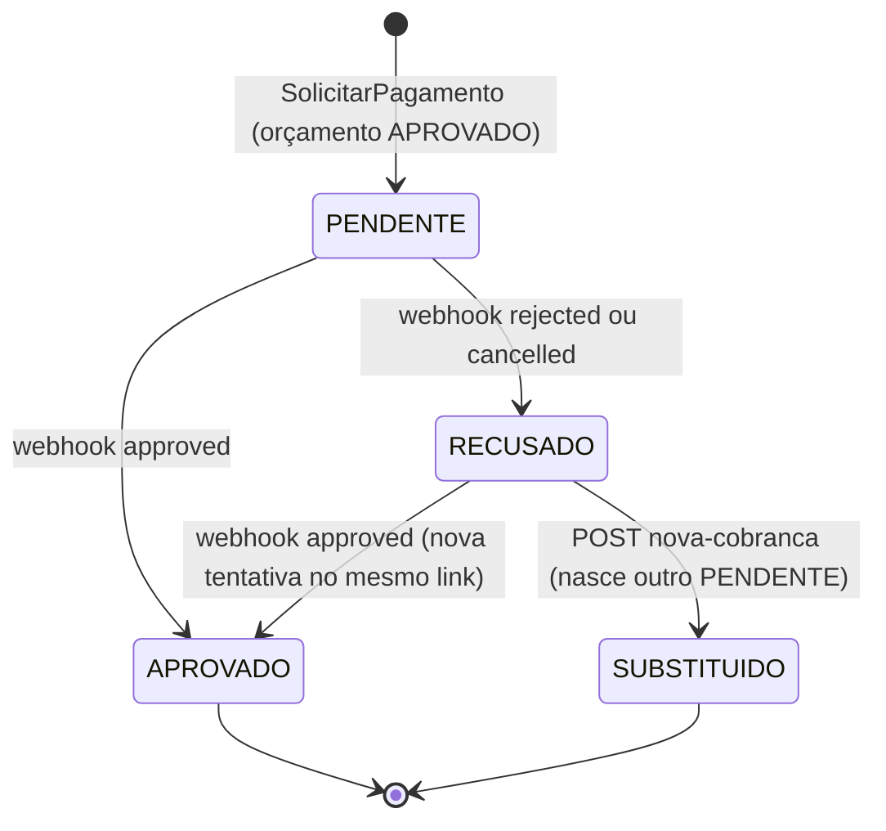

# fiap-soat-mecanica-billing

Microsserviço **billing** da **Fase 4** da Oficina Mecânica do Braia (Tech Challenge FIAP SOAT).

> 🚧 Rascunho da F6. As seções marcadas com *TODO* são completadas e revisadas na F9.

## Responsabilidade

O Billing é o dono do **orçamento e do pagamento**:

- o orçamento de cada OS: gerado a partir do diagnóstico, aprovado ou recusado pelo cliente, expirado pelo próprio Billing (TTL) ou cancelado pela Saga;
- a cobrança no **Checkout Pro do Mercado Pago** (sandbox): uma preferência por pagamento e o link entregue ao cliente;
- o **webhook** do Mercado Pago, que confirma ou recusa o pagamento;
- o lado do Billing na Saga da OS: responde aos comandos `GerarOrcamento`, `CancelarOrcamento` e `SolicitarPagamento`.

Os dados ficam no RDS Postgres `billing_db` (nenhum outro serviço lê o banco). OS, diagnóstico, estoque e cliente são de outros serviços (ADR-F4-01). Nenhum dado de cartão passa pelo Billing: a página de pagamento é do Mercado Pago.

## Arquitetura

- Spring Boot 3.5, Java 21 (virtual threads), arquitetura hexagonal: `domain/`, `application/`, `adapters/in|out/`, `config/`.
- Autenticação: JWT RS256 emitido pelo Identity, validado aqui também (defesa em profundidade). Públicos só `/actuator/health/**`, o Swagger, `/error` e o webhook (que tem a própria assinatura).
- Persistência: JPA + Flyway (V1 a V5), com `@Version` no orçamento e no pagamento.
- Mensageria: AWS SDK v2 direto (SNS e SQS), com outbox transacional e consumidor idempotente.
- Mercado Pago: `RestClient` próprio (`MercadoPagoClient`), sem o `sdk-java` (RFC-F4-01).
- Observabilidade: logs JSON com `correlationId`, métricas OTLP e agente OpenTelemetry injetado no EKS (Datadog).

```
REST (cliente, atendente) ──► controllers ──► casos de uso ──┐
                                                             ├──► Postgres (orçamento, pagamento, outbox)
mecanica-billing-comandos ──► SqsConsumidor ──► handlers ────┤
                                                             │
Mercado Pago ──► POST /webhooks/mercadopago ──► webhook_eventos (200 na hora)
                      ProcessadorWebhookScheduler (2 s) ◄────┘ consulta GET /v1/payments/{id}

SNS mecanica-billing-eventos ◄── OutboxPublisher (1 s)
ExpiracaoOrcamentoScheduler (30 s): GERADO vencido → EXPIRADO
MercadoPagoClient ──► POST /checkout/preferences · GET /v1/payments/{id}
```

## API

| Rota | Perfil |
|---|---|
| `GET /orcamentos/{id}` | CLIENTE (dono) ou ATENDENTE |
| `GET /orcamentos/por-os/{osId}` (o vivo ou, sem ele, o mais recente) | CLIENTE (dono) ou ATENDENTE |
| `PATCH /orcamentos/{id}/aprovar` · `/recusar` (`{motivo?}`) | CLIENTE (dono) ou ATENDENTE |
| `GET /pagamentos/por-os/{osId}` (o vigente, com o `link`, e o histórico) | CLIENTE (dono) ou ATENDENTE |
| `POST /pagamentos/{osId}/nova-cobranca` (→ 201) | ATENDENTE |
| 🔓 `POST /webhooks/mercadopago` | público, validado por HMAC (`x-signature`) |

O dono vem do `clienteId` do `GerarOrcamento`. Um CLIENTE em recurso de outro cliente recebe **403** `ORCAMENTO_DE_OUTRO_CLIENTE`; um id inexistente, 404; MECANICO e ALMOXARIFE, 403. Outros erros: 422 (regra de negócio: aprovar fora de `GERADO` ou depois de `expiraEm`, nova cobrança sem pagamento `RECUSADO`), 409 `CONFLITO_CONCORRENTE` (o cliente repete) e 502 `MERCADOPAGO_INDISPONIVEL` (nova cobrança com o Mercado Pago fora). A tabela completa está em `docs/contratos/rotas.md` do `-k8s`.

Swagger: `/billing/swagger-ui.html` (via Traefik) ou `/swagger-ui.html` (local).

## Estados do orçamento e do pagamento



Só há **um orçamento vivo** (`GERADO` ou `APROVADO`) por OS, garantido por índice único parcial. O Billing recalcula o total a partir dos itens (`BigDecimal`, 2 casas, `HALF_EVEN`, tolerância zero): divergência com o `valorTotal` do comando, ou item sem valor, gera `OrcamentoFalhou` e nada é criado. Um `GerarOrcamento` de nova rodada cancela o `GERADO` anterior, porque o `CancelarOrcamento` da revisão pode chegar depois dele (as filas são padrão, sem ordem).



Há **um pagamento vigente** por OS (índice único parcial, sem `SUBSTITUIDO`). Só o vigente gera evento: uma aprovação num `SUBSTITUIDO` é ignorada, com o log `pagamento_em_cobranca_substituida` e a métrica `pagamento.substituido_aprovado` (estorno manual).

## Mercado Pago

Resumo da [RFC-F4-01](https://github.com/fiap-postech-soat-lf/fiap-soat-mecanica-k8s/blob/main/docs/arquitetura-fase4/rfc/RFC-F4-01-mercado-pago.md).

- **Checkout Pro** (redirecionamento) no sandbox. No teste, o titular do cartão escolhe o resultado: `APRO` (aprovado) gera `PagamentoConfirmado`, e `OTHE` (recusado) gera `PagamentoRecusado`.
- **Cliente:** duas chamadas, `POST /checkout/preferences` (um item em BRL, `external_reference = pagamentoId`, `X-Idempotency-Key = pagamentoId`, sem `notification_url`) e `GET /v1/payments/{id}`. Timeout de 5 s e retry de 3 tentativas (500 ms × 2), só em I/O, timeout ou 5xx. O token do usuário nunca sai para o Mercado Pago.
- **Cobrança:** o handler de `SolicitarPagamento` cria o `Pagamento` e a preferência na mesma transação. Se o Mercado Pago falhar, a transação é desfeita e a mensagem volta à fila (o OS reenvia). O link é o `init_point` (`app.mercadopago.link`).
- **Webhook:** `POST /webhooks/mercadopago` valida o `x-signature` (`ts=<ts>,v1=<hex>`): HMAC-SHA256 do manifesto `id:<data.id>;request-id:<x-request-id>;ts:<ts>;`, com `data.id` em minúsculas e comparação em tempo constante. Assinatura ausente ou inválida → **401 sem gravar nada**. `type` diferente de `payment` → 200 sem efeito. Senão, grava em `webhook_eventos` e responde 200 na hora.
- **Processamento:** o `ProcessadorWebhookScheduler` (2 s, `FOR UPDATE SKIP LOCKED`) consulta o pagamento no Mercado Pago (o status **nunca** vem do corpo) e aplica o resultado:

  | Status no Mercado Pago | Efeito |
  |---|---|
  | `approved` | `APROVADO` e `PagamentoConfirmado` |
  | `rejected`, `cancelled` | `RECUSADO` e `PagamentoRecusado` (`motivo` = `status_detail`) |
  | `pending`, `in_process`, `authorized` | nenhum; espera a próxima notificação |
  | outro, ou `external_reference` desconhecida | `IGNORADO`, com log |

  A chave `(payment.id, status)` em `mp_status_aplicado` (PK) garante um efeito só por mudança de status, mesmo com `payment.created` e `payment.updated` repetidos. Falha do Mercado Pago → nova tentativa com backoff 2^n s e, na 5ª, `ERRO` e a métrica `mercadopago.erros`.
- **URL do webhook por janela:** o webhook fica na aplicação `mecanica-fase4` do Mercado Pago, e não na preferência. O API Gateway é recriado a cada subida do ambiente, então, em toda janela com pagamento, a URL `<api-url>/webhooks/mercadopago` é regravada (`callback` e `callback_sandbox`, tópico `payment`) pelo MCP `save_webhook` ou pelo painel, e o segredo da assinatura é conferido (se mudar, todo webhook responde 401). Não é Terraform.
- **Limites aceitos:** sandbox apenas; nenhum estorno automático; o webhook não alcança a máquina local (a prova real é no EKS, e os testes usam requisições assinadas e WireMock).

## Mensagens

Contratos produzidos em `docs/contratos/` e consumidos em `src/test/resources/contratos-consumidos/` (copiados do `-os`; o `ContratosConsumidosTest` desserializa cada exemplo no record do handler). Regra de congelamento em `docs/contratos/convencoes.md` do `-k8s`.

| Consome (fila `mecanica-billing-comandos`) | Handler |
|---|---|
| `GerarOrcamento`, `CancelarOrcamento`, `SolicitarPagamento` | um `*Handler` por tipo, em `adapters/in/messaging/` |

| Publica (tópico `mecanica-billing-eventos`) | Quando |
|---|---|
| `OrcamentoGerado` · `OrcamentoFalhou` | `GerarOrcamento` (resposta, reemitida no reenvio) |
| `CobrancaCriada` | `SolicitarPagamento` (resposta, reemitida no reenvio) e `POST nova-cobranca` |
| `OrcamentoAprovado` · `OrcamentoRecusado` | `PATCH aprovar` e `PATCH recusar` |
| `OrcamentoExpirado` | scheduler de expiração |
| `PagamentoConfirmado` · `PagamentoRecusado` | webhook processado |

O `CancelarOrcamento` não tem resposta: ele é idempotente pelo estado do orçamento.

**Idempotência e reemissão (F4-h, F6-c):** o `ProcessadorMensagemSql` registra o `messageId` na mesma transação do handler. Como o OS reenvia comandos com `messageId` novo, a tabela `comando_atendido` (PK `os_id` + `tipo`) guarda a **cadeia de ids** e a **resposta**. Um comando cujo `messageId` ou `causationId` está na cadeia é um reenvio: a resposta guardada é reemitida num envelope novo (`causationId` = o `messageId` recebido), sem efeito de negócio e sem nova preferência no Mercado Pago. Um comando fora da cadeia é uma nova rodada e substitui a linha.

**Expiração (F6-f):** o Billing é dono do TTL. O `ExpiracaoOrcamentoScheduler` (30 s, `FOR UPDATE SKIP LOCKED`, até 20 por rodada) passa os `GERADO` vencidos a `EXPIRADO` e emite `OrcamentoExpirado`. Aprovar ou recusar depois de `expiraEm` dá 422, mesmo antes de o scheduler rodar.

## Configuração

| Propriedade | Variável | Padrão / origem |
|---|---|---|
| `app.security.jwt.public-key` | `JWT_PUBLIC_KEY` | `app_config` (SSM do Identity) |
| `app.messaging.consumidor.filas` | `APP_MESSAGING_CONSUMIDOR_FILAS` | URL da `mecanica-billing-comandos` |
| `app.messaging.dlqs` | `APP_MESSAGING_DLQS` | URL da DLQ |
| `app.messaging.destinos.billing-eventos` | `MESSAGING_DESTINO_BILLING_EVENTOS` | ARN do tópico |
| `app.orcamento.ttl` · `app.orcamento.expiracao.intervalo` | — | `PT24H` (perfil `demo`: `PT2M`) · `PT30S` |
| `app.mercadopago.base-url` | — | `https://api.mercadopago.com` |
| `app.mercadopago.access-token` | `MP_ACCESS_TOKEN` | `app_secrets` (Secrets Manager) |
| `app.mercadopago.webhook-secret` | `MP_WEBHOOK_SECRET` | `app_secrets` (Secrets Manager) |
| `app.mercadopago.timeout` · `app.mercadopago.retry.*` | — | `PT5S` · 3 tentativas, 500 ms × 2 |
| `app.mercadopago.link` | — | `init_point` (alternativa: `sandbox_init_point`) |
| `app.webhook.processador.intervalo` · `.max-tentativas` | — | `PT2S` · `5` |

Sem `MP_ACCESS_TOKEN`, o Billing sobe, loga `mercadopago_token_ausente` e as cobranças falham (a mensagem vai para a DLQ depois de 5 recebimentos). Sem `MP_WEBHOOK_SECRET`, o webhook responde 401. Nenhum segredo é versionado.

## Como rodar localmente

```bash
docker compose -f ../fiap-soat-mecanica-k8s/local/docker-compose.yml up -d   # LocalStack e Postgres
./mvnw spring-boot:run -Dspring-boot.run.profiles=local
curl localhost:8083/actuator/health
```

Para ver o orçamento nascer, suba também o OS, o Execução e o Identity (`../fiap-soat-mecanica-*`): concluído o diagnóstico, `GET localhost:8083/orcamentos/por-os/{osId}` com o token do cliente mostra o `GERADO`. Para ver a expiração sem esperar 24 h, use `--spring.profiles.active=local,demo` (TTL de 2 min).

Token de dev: `../fiap-soat-mecanica-k8s/local/jwt/gerar-token-dev.sh CLIENTE`. Para cobrar de verdade no sandbox, exporte `MP_ACCESS_TOKEN` **só na sessão do terminal** (nunca em arquivo). O webhook não é testável localmente: o Mercado Pago só chama uma URL pública.

## Testes e qualidade

```bash
./mvnw verify   # unitários + integração (Testcontainers + LocalStack + WireMock), JaCoCo ≥ 80% de linhas
```

Os ITs sobem um Postgres, um LocalStack (SNS e SQS) e um único contexto Spring, com o WireMock no lugar do Mercado Pago. Destaques: `OrcamentoSagaIT` (reemissão e nova rodada), `ExpiracaoOrcamentoIT`, `CobrancaSagaIT`, `NovaCobrancaIT`, `WebhookIT` (assinatura, 3 notificações → 1 evento), `PagamentoFluxoIT`, `PerfisIT` (matriz de perfis) e `MigracoesIT` (índices parciais). Cada envelope produzido é validado contra o schema do próprio Billing. O `./mvnw verify` do PR do webhook teve 342 testes e 98,2% de cobertura de linhas. O CI (`ci / build`) roda os testes e a análise no SonarCloud (`fiap-postech-soat-lf_fiap-soat-mecanica-billing`) com espera do Quality Gate.

## Deploy e `infra/`

O CD (`servico-cd.yml@v1`) roda após o CI verde na `main`: `terraform apply` do `infra/` → imagem no ECR → ConfigMap/Secret → `kubectl apply` dos manifestos `k8s/` → rollout e smoke do health. Com o EKS desligado, termina verde sem deploy.

O `infra/` cria o ECR, o RDS `billing_db`, o tópico `mecanica-billing-eventos`, a fila `mecanica-billing-comandos` (com DLQ), os secrets `mercadopago-access-token` e `mercadopago-webhook-secret` (`recovery_window_in_days = 0`) e os parâmetros SSM que o OS lê. O `app_config` tem 6 chaves e o `app_secrets`, 4 (usuário e senha do banco, `MP_ACCESS_TOKEN` e `MP_WEBHOOK_SECRET`). As variáveis `mp_access_token` e `mp_webhook_secret` são `sensitive` e sem default: sem elas, o `plan` falha. Contrato com o CD e lista de recursos em [`infra/README.md`](infra/README.md).

## Decisões

ADRs transversais e RFCs no `-k8s` (`docs/arquitetura-fase4/`): ADR-F4-02 (Saga), ADR-F4-03 (SNS + SQS), ADR-F4-04 (outbox e consumidor idempotente), ADR-F4-05 (database per service) e RFC-F4-01 (Mercado Pago). Decisões só deste serviço ficam em `docs/adr/`.

## TODO (F9)

- Diagrama de componentes revisado.
- Exemplos de `curl` para o fluxo do orçamento e da nova cobrança.
- Link para o vídeo de demonstração.
